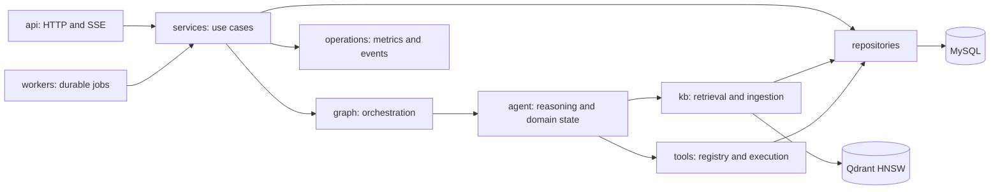
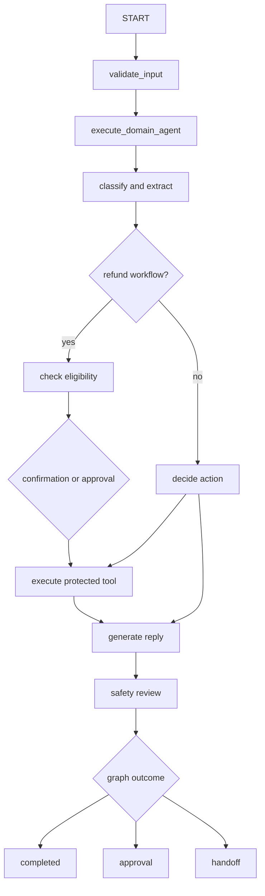
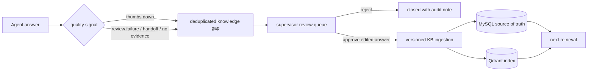

# MyTicket Architecture

MyTicket adopts the same high-level separation that makes MewHelp easy to
navigate, while retaining MyTicket's stronger API/application layering,
Alembic migrations, worker, React frontend and production observability.

This is intentionally not a file-for-file copy. MewHelp's readable
`api / graph / core / kb / tools / db` idea is retained, while MyTicket keeps
SQLAlchemy models and repositories separate, keeps the React application as an
independent deployable, and uses Alembic rather than chapter-numbered SQL.

## Directory map

| Directory | Single responsibility |
|---|---|
| `backend/app/api/` | HTTP/SSE transport, authentication dependencies and request validation |
| `backend/app/graph/` | LangGraph state, nodes, routing, topology and runtime |
| `backend/app/agent/` | Customer-service reasoning, domain state, policies and refund workflow |
| `backend/app/kb/` | Chunking, embedding, retrieval, vector index and knowledge ingestion |
| `backend/app/tools/` | Tool schemas, registry, execution engine and business tool adapters |
| `backend/app/services/` | Application use cases and transaction coordination |
| `backend/app/models/` | SQLAlchemy persistence models |
| `backend/app/repositories/` | Database queries and persistence operations |
| `backend/app/core/` | Configuration, security and logging infrastructure |
| `backend/app/operations/` | Metrics, rate limiting and operational validation |
| `backend/app/evals/` | Offline evaluators, reports and quality gates |
| `backend/app/workers/` | Durable asynchronous Agent task consumption |

The legacy imports under `app.agent.rag`, `app.agent.vector_index`,
`app.agent.embedding`, `app.agent.tool_executor` and
`app.agent.langgraph_runtime` remain temporarily supported. New application
code must import graph, knowledge-base and tool runtime capabilities from
`app.graph`, `app.kb` and `app.tools`.

## Runtime dependency flow

Dependencies point inward toward explicit capabilities. API code does not
perform business persistence directly; graph nodes do not open database
sessions; tools receive trusted identity through `ToolExecutionContext`; and
MySQL remains the source of truth for durable Agent checkpoints.

## Agent execution flow

The outer graph owns lifecycle routing. `CustomerServiceAgent` owns domain
reasoning. `ToolExecutor` owns policy enforcement, argument validation,
trusted-context injection, timeout/retry and audit metadata. These boundaries
must not be collapsed into a single node or service.

## Knowledge flow

1. `app.kb.chunking` normalizes and splits a document.
2. `app.kb.service` persists versioned chunks and optional embeddings.
3. MySQL stores the auditable source of truth.
4. Qdrant stores the replaceable HNSW serving index.
5. `app.kb.retrieval` combines keyword and vector candidates.
6. Retrieved vector IDs are resolved against active MySQL records before use.
7. Evaluation uses the same retriever boundary as production.

## Feedback learning loop

The system never trains on raw customer feedback automatically. It fingerprints
equivalent questions, counts recurring failures, and requires a supervisor to
edit and approve an answer before normal knowledge ingestion runs. Feedback,
gap decisions, generated documents and domain events remain auditable. The
Prometheus counters `myticket_message_feedback_total` and
`myticket_knowledge_gaps_total` expose the operational volume and outcomes.

## Change rules

- New graph nodes go in `app/graph/nodes.py`; topology changes go only in
  `app/graph/build.py`; branch conditions go in `app/graph/routing.py`.
- New business tools go in `app/tools/`, are registered once, and are called
  only through `app.tools.engine.ToolExecutor`.
- New retrieval strategies implement the `app.kb` boundary instead of being
  embedded inside API or Agent orchestration code.
- Services coordinate transactions; repositories contain queries; neither
  graph nodes nor prompts should contain raw SQL.
- Every high-risk state mutation needs trusted backend context, confirmation
  or approval, idempotency and a stateful benchmark case.
