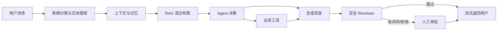

# MyTicket — 可观测的电商售后 Agent

MyTicket 是一个面向电商售后的完整 Agent 应用原型。它不只生成客服话术，还会结合多轮上下文、长期记忆和 RAG 知识库做决策，调用订单/物流/退款工具，并在高风险场景进入人工审批。

## 业务场景

- 订单查询：识别订单号并查询订单状态
- 物流追踪：查询承运商、当前位置和预计送达时间
- 退款申请：检查资格、要求用户明确确认、幂等创建退款
- 异常售后：已发货、高金额或安全审核未通过时转人工
- 连续对话：从近期消息、历史摘要和长期记忆恢复上下文

## 完整链路



前端通过 NDJSON 流实时展示“理解问题 → 检索知识 → 执行工具 → 生成回复”，最终回复以打字效果输出。右侧 Trace 面板展示每次运行的决策、RAG 命中、工具、记忆和耗时。

## 技术栈

- 后端：FastAPI、SQLAlchemy Async、MySQL、Pydantic
- Agent：状态驱动 workflow、工具注册与执行、确认检查点、Reviewer
- 上下文：短期消息选择、历史摘要、长期用户记忆
- RAG：关键词与向量混合检索
- 前端：React 19、TypeScript、Vite
- 质量：Pytest、Agent/RAG 离线评测、运行 Trace

## 本地启动

### 1. 后端

```powershell
cd MyTicket\backend
python -m venv .venv
.\.venv\Scripts\python.exe -m pip install -e ".[dev]"
Copy-Item .env.example .env
# 编辑 .env：至少设置 DATABASE_URL、JWT_SECRET；使用模型时再设置 DASHSCOPE_API_KEY
python -m alembic upgrade head
python seed_demo_data.py
python -m uvicorn app.main:app --reload
```

默认配置采用 `LLM_ENABLED=false`、`EMBEDDING_ENABLED=false`，使用规则分类、规则决策和关键词检索，可以无外部模型启动。接入 DashScope 时，在 `.env` 中显式开启对应开关并配置密钥；启动校验会阻止“已开启但没有密钥”的错误配置。

浏览器登录使用 `HttpOnly`、`SameSite=Strict` 会话 Cookie，不再把 JWT
保存在 `localStorage`；Bearer Token 仍保留给 Swagger 和 API 客户端。HTTPS
部署时必须设置 `AUTH_COOKIE_SECURE=true`。注销接口会显式清除会话 Cookie。

API 和 Worker 默认输出 JSON 结构化日志。安全校验后的 `X-Request-ID` 会写入
日志上下文，并持久化到对应 `AgentRun.correlation_id`，可从一次 HTTP 请求追踪到
Agent 执行记录；异步任务使用 `task-<id>-attempt-<n>` 作为关联 ID。

Prometheus 可抓取 `GET /metrics`，包含低基数路由模板的 HTTP 请求量/延迟、
Worker 任务结果/耗时，以及 Agent 结果、RAG 命中/降级和工具成功率。业务指标仅在
`AgentRun` 成功提交后记录，避免数据库回滚造成虚假成功。共享网络部署应设置
`METRICS_BEARER_TOKEN`，或在网关层限制指标端点；配置 Token 后抓取端也必须发送
相同的 Bearer 认证头。

API 与 Worker 是不同进程，因此 Compose 中 Prometheus 会分别抓取
`backend:8000/metrics` 和仅在私有网络暴露的 `worker:9101/metrics`；不能假设 API
端点会自动汇总 Worker 进程内的计数。本地直接运行 Worker 时指标端口默认关闭，设置
`AGENT_WORKER_METRICS_PORT` 后才会启用。

### 2. 前端

```powershell
cd MyTicket\frontend
npm install
npm run dev
```

访问 `http://localhost:5173`。

### Docker Compose

```powershell
Copy-Item .env.compose.example .env
# 修改 .env 中的数据库密码和至少 32 字符的 JWT_SECRET
docker compose up --build
```

Compose 会启动 MySQL、Redis、API、异步 Agent Worker 和前端，并在 API 启动前自动执行数据库迁移。Redis 使用原子滑动窗口统一多实例登录与 Agent 限流；readiness 会同时检查数据库和 Redis。首次启动后可在 backend 容器中运行 `python seed_demo_data.py` 和 `python seed_knowledge_base.py` 写入演示数据。

需要演示完整监控时，启用可选 profile：

```powershell
docker compose --profile monitoring up --build
```

- Grafana：`http://localhost:3000`，账号 `admin`，密码取自
  `GRAFANA_ADMIN_PASSWORD`
- Prometheus：`http://localhost:9090`
- 预置仪表盘：`MyTicket / MyTicket Overview`
- 预置告警：API 不可用、5xx/延迟升高、Worker 失败或租约丢失、Agent 高转人工率、
  Tool 失败与 RAG 高频降级
- 告警处置说明：见 `monitoring/README.md`

仓库内的 Prometheus 示例假设 `METRICS_BEARER_TOKEN` 为空，并依赖 Compose 私有网络
访问指标端点。生产环境若启用 Token，应通过 Secret 文件为 Prometheus 配置
`authorization.credentials_file`，不要把 Token 提交进配置文件；Grafana 默认密码也必须
修改。告警阈值是演示基线，需要按真实流量、错误预算和 on-call 反馈校准。

异步任务使用数据库 `SKIP LOCKED` 认领、租约心跳和 attempt fencing。Worker
崩溃后任务可被重新认领；旧 Worker 丢失租约后会取消本地执行，不能用过期
attempt 完成或续租任务。达到最大尝试次数的过期任务会转为 `DEAD`，不会永久
停留在 `RUNNING`。

演示账户：

- 邮箱：`demo@example.com`
- 密码：`DemoPass123!`

管理员演示账户（仅由本地 `seed_demo_data.py` 创建）：

- 邮箱：`admin@example.com`
- 密码：`AdminPass123!`

部署到共享或生产环境前必须通过环境变量修改或禁用这些演示凭据。

## 稳定演示数据

| 编号 | 状态 | 适合演示 |
|---|---|---|
| 10001 | 已付款、未发货、¥299 | 自动退款资格检查与用户确认 |
| 10002 | 已发货、运输中、¥499 | 订单状态查询 |
| 10003 | 已完成、已签收、¥1299 | 售后退款转人工 |
| 10004 | 已退款、¥899 | 防止重复退款 |
| 10005 | 物流异常、高金额 ¥6999 | 风险场景与人工审批 |
| SF123456 | 运输中 | 正常物流查询 |
| YT888888 | 已签收 | 已完成物流查询 |
| JD100005 | 运输异常 | 异常物流演示 |

推荐演示脚本：

1. 新建工单：“我的订单 10002 到哪里了？”
2. 继续追问：“就是刚才那个订单，什么时候能到？”
3. 新建退款工单：“订单 10001 不想要了，帮我退款。”
4. Agent 要求确认后回复：“确认退款。”
5. 使用订单 10003 或 10005 展示转人工，并在管理员审批页查看依据。

## 测试与评测

```powershell
cd backend
.\.venv\Scripts\python.exe -m pytest -q
.\.venv\Scripts\python.exe -m pytest tests\evals -q

cd ..\frontend
npm run build
```

也可以从项目根目录执行统一发布前检查。它会验证配置、依赖、迁移头、后端测试、
离线 Benchmark、质量门禁和前端构建，并把本次报告写入
`benchmark/reports/verification`：

```powershell
.\scripts\verify_release.ps1
```

安装 Docker 并准备好 `.env` 后，可额外验证完整 Compose 展开结果：

```powershell
.\scripts\verify_release.ps1 -DockerConfig
```

这个本地检查不会把 `--skip-rag` 的结果冒充为真实 RAG 指标；完整 Recall@5/MRR@10
仍由 MySQL CI 任务或已灌入知识库的本地数据库产生。

评测集位于：

- `backend/evals/agent_cases.json`：分类、实体提取、确认识别、安全审核
- `backend/evals/rag_cases.json`：知识召回

生产级评估入口位于 `benchmark/`，新增了：

- RAG `Recall@5`、`MRR@10` 与无关问题拒绝率
- 跨分类、实体、上下文、确认和安全的 Agent 任务成功率
- 安全误拦率（False Block Rate）与漏放率（False Allow Rate）
- JSON、CSV、Markdown 实验报告
- 样本量、95% Wilson 置信区间、数据集哈希和运行参数
- 可重复使用的合成政策、订单与工单数据

无需数据库即可先运行组件、任务和安全评估：

```powershell
cd backend
python run_benchmark.py --skip-rag
```

知识库已初始化后，运行完整关键词基线或混合检索实验：

```powershell
python run_benchmark.py
python run_benchmark.py --hybrid
```

`--hybrid` 只在 `EMBEDDING_ENABLED=true` 且已配置有效的
`DASHSCOPE_API_KEY` 时运行；否则脚本会直接报错，避免把关键词检索结果误标为
Hybrid 实验。

报告默认保存在 `benchmark/reports/runs/<UTC-run-id>`，每次运行独立留档。当前任务评估是离线规则组件回归，并非在线大模型端到端成功率；报告中的 `evaluation_mode` 与 `end_to_end` 字段会明确这一边界。

CI 分为 SQLite 快速回归、MySQL 8.4 集成和前端构建三个任务。MySQL
任务会从空库执行 Alembic、灌入企业模拟数据与知识库，然后运行关键词 RAG
Benchmark 和质量门禁，并上传报告 Artifact。

## 项目亮点

1. Agent 会执行真实业务动作，而不是仅包装 LLM 对话。
2. 退款采用“资格检查 → 用户确认 → 幂等执行”的安全工作流。
3. 高风险结果进入 Human-in-the-loop，不直接执行。
4. 每次运行记录分类、RAG、记忆、工具、Reviewer 和耗时，便于审计。
5. 规则 fallback、离线评测和自动化测试让系统可稳定演示。

## 生产化边界

当前订单、物流和退款数据是本地演示数据。接入生产时，应将工具层替换为真实订单中心、物流平台与支付/退款服务，并补充权限审计、消息队列、日志聚合、告警通知路由和隐私合规策略。仓库提供的 Grafana/Prometheus 是单机演示栈，不替代高可用监控基础设施。

## 参与贡献与安全报告

- 开发、测试和 Pull Request 要求见 `CONTRIBUTING.md`
- 安全问题请按 `SECURITY.md` 私下报告，不要在公开 Issue 中提交漏洞细节、密钥或真实客户数据

## 开源许可证

本项目采用 [MIT License](LICENSE)。允许学习、使用、修改和再发布，但需保留原始版权和许可证声明。
- 仓库中的账户、订单、物流和政策均为合成演示数据；任何 `.env` 与真实凭据都不应提交
