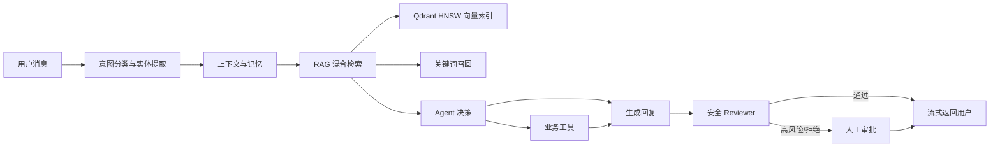

# MyTicket — 可观测的电商售后 Agent

MyTicket 是一个面向电商售后的完整 Agent 应用原型。它不只生成客服话术，还会结合多轮上下文、长期记忆和 RAG 知识库做决策，调用订单/物流/退款工具，并在高风险场景进入人工审批。

## 业务场景

- 订单查询：识别订单号并查询订单状态
- 物流追踪：查询承运商、当前位置和预计送达时间
- 退款申请：检查资格、要求用户明确确认、幂等创建退款
- 异常售后：已发货、高金额或安全审核未通过时转人工
- 连续对话：从近期消息、历史摘要和长期记忆恢复上下文

## 完整链路



前端通过 NDJSON 流实时展示“理解问题 → 检索知识 → 执行工具 → 生成回复”，最终回复以打字效果输出。右侧 Trace 面板展示每次运行的决策、RAG 命中、工具、记忆和耗时。

## 技术栈

- 后端：FastAPI、SQLAlchemy Async、MySQL、Pydantic
- Agent：LangGraph 生命周期编排、领域状态机、工具执行、确认检查点、Reviewer
- 上下文：短期消息选择、历史摘要、长期用户记忆
- RAG：关键词召回、Qdrant HNSW 向量索引与加权融合
- 前端：React 19、TypeScript、Vite
- 质量：Pytest、Agent/RAG 离线评测、运行 Trace

## 代码结构

后端按 `api / graph / agent / kb / tools / services / repositories` 分层：

| 目录 | 职责 |
|---|---|
| `app/api` | HTTP、SSE、鉴权和输入边界 |
| `app/graph` | LangGraph 状态、节点、路由、组图与运行入口 |
| `app/agent` | 客服领域状态、决策、安全策略和退款子流程 |
| `app/kb` | 切块、Embedding、混合检索、向量索引和知识入库 |
| `app/tools` | 工具 Schema、注册表、统一执行引擎和业务工具 |
| `app/services` | 应用用例、事务和 Agent/人工协作流程 |
| `app/repositories` | 数据库读写，不承载 Agent 决策 |
| `app/evals` | Agent、RAG、安全和有状态工具评测 |

LangGraph 的图结构可直接从 `app/graph/build.py` 阅读；详细依赖方向、Agent
执行链和扩展规则见 [ARCHITECTURE.md](ARCHITECTURE.md)。旧的 Agent 内部导入路径暂时
保留兼容，新代码统一从 `app.graph`、`app.kb` 和 `app.tools` 引用。

## 本地启动

### 1. 后端

```powershell
cd MyTicket\backend
python -m venv .venv
.\.venv\Scripts\python.exe -m pip install -e ".[dev]"
Copy-Item .env.example .env
# 编辑 .env：至少设置 DATABASE_URL、JWT_SECRET；使用模型时再设置 DASHSCOPE_API_KEY
python -m alembic upgrade head
python seed_demo_data.py
python -m uvicorn app.main:app --reload
```

默认配置采用 `LLM_ENABLED=false`、`EMBEDDING_ENABLED=false`、
`QDRANT_ENABLED=false`，使用规则分类、规则决策和关键词检索，可以无外部模型
启动。接入 DashScope 时，在 `.env` 中显式开启对应开关并配置密钥；启动校验会
阻止“已开启但没有密钥”以及“开启 Qdrant 但没有开启 embedding”的错误配置。

### 真正的向量索引

启用下列配置后，在线语义召回会使用 Qdrant 的 HNSW 近似最近邻索引，而不是在
Python 中遍历全部向量：

```dotenv
DASHSCOPE_API_KEY=your-key
EMBEDDING_ENABLED=true
QDRANT_ENABLED=true
QDRANT_URL=http://localhost:6333
```

MySQL 仍保存文档、分块和 embedding，是可审计、可重建的事实源；Qdrant 只保存
向量、chunk ID 和最小元数据。检索命中后必须回查 MySQL 且只接受有效文档，避免
把已经停用或残留的向量直接送入 Agent。文档新增、更新和停用会同步增删 Qdrant
point。Qdrant 故障时系统依次降级到本地余弦扫描和关键词检索，并在 RAG Trace 的
`vector_backend` 中记录 `qdrant_hnsw`、`local_scan` 或
`local_scan_fallback`。

已有知识库启用 Qdrant 后执行一次全量重建：

```powershell
cd backend
python reindex_vector_store.py
```

脚本会为缺少向量的有效 chunk 补算 embedding，并以 MySQL 数据重建索引。若更换
embedding 模型或维度，应使用新的 `QDRANT_COLLECTION` 名称重建，不能把不同维度
写入同一 collection。

浏览器登录使用 `HttpOnly`、`SameSite=Strict` 会话 Cookie，不再把 JWT
保存在 `localStorage`；Bearer Token 仍保留给 Swagger 和 API 客户端。HTTPS
部署时必须设置 `AUTH_COOKIE_SECURE=true`。注销接口会显式清除会话 Cookie。

Agent 外层生命周期由 LangGraph `StateGraph` 编排：输入校验、领域 Agent 执行以及
自动完成、主管审批、人工接管三条条件分支均是显式图节点。分类、RAG、实体抽取、
工具与回复审查继续保留为可独立测试的领域组件；持久状态统一写入 MySQL
`AgentRun.state_snapshot`，避免再引入一套内存 checkpoint 作为冲突的数据源。

API 和 Worker 默认输出 JSON 结构化日志。安全校验后的 `X-Request-ID` 会写入
日志上下文，并持久化到对应 `AgentRun.correlation_id`，可从一次 HTTP 请求追踪到
Agent 执行记录；异步任务使用 `task-<id>-attempt-<n>` 作为关联 ID。

Prometheus 可抓取 `GET /metrics`，包含低基数路由模板的 HTTP 请求量/延迟、
Worker 任务结果/耗时，以及 Agent 结果、RAG 命中/降级和工具成功率。业务指标仅在
`AgentRun` 成功提交后记录，避免数据库回滚造成虚假成功。共享网络部署应设置
`METRICS_BEARER_TOKEN`，或在网关层限制指标端点；配置 Token 后抓取端也必须发送
相同的 Bearer 认证头。

API 与 Worker 是不同进程，因此 Compose 中 Prometheus 会分别抓取
`backend:8000/metrics` 和仅在私有网络暴露的 `worker:9101/metrics`；不能假设 API
端点会自动汇总 Worker 进程内的计数。本地直接运行 Worker 时指标端口默认关闭，设置
`AGENT_WORKER_METRICS_PORT` 后才会启用。

### 2. 前端

```powershell
cd MyTicket\frontend
npm install
npm run dev
```

访问 `http://localhost:5173`。

### Docker Compose

```powershell
Copy-Item .env.compose.example .env
# 修改 .env 中的数据库密码和至少 32 字符的 JWT_SECRET
docker compose up --build
```

Compose 默认启动 MySQL、Redis、API、异步 Agent Worker 和前端，`vector` profile
会额外启动 Qdrant；API 启动前会自动执行数据库迁移。Redis 使用原子滑动窗口统一
多实例登录与 Agent 限流；开启 Qdrant 后 readiness 会报告向量 collection 状态。首次启动后
可在 backend 容器中运行 `python seed_demo_data.py` 和
`python seed_knowledge_base.py` 写入演示数据。基础设施端口和访问凭据请只在本地
`.env` 与部署平台 Secret 中维护，不在公开说明中列出。

需要启用真正的向量索引时，在 `.env` 配置 DashScope、embedding 与 Qdrant 开关，
然后启用 `vector` profile：

```powershell
docker compose --profile vector up --build
docker compose exec backend python seed_knowledge_base.py
```

Qdrant 不属于 API 的强依赖：不可用时 readiness 返回
`"vector_index": "degraded"`，API 仍可借助本地向量和关键词降级路径提供服务。

需要演示完整监控时，启用可选 profile：

```powershell
docker compose --profile monitoring up --build
```

若要同时演示向量索引和监控，使用
`docker compose --profile vector --profile monitoring up --build`。

- 预置告警：API 不可用、5xx/延迟升高、Worker 失败或租约丢失、Agent 高转人工率、
  Tool 失败与 RAG 高频降级
- 告警处置说明：见 `monitoring/README.md`

仓库内的 Prometheus 示例假设 `METRICS_BEARER_TOKEN` 为空，并依赖 Compose 私有网络
访问指标端点。生产环境若启用 Token，应通过 Secret 文件为 Prometheus 配置
`authorization.credentials_file`，不要把 Token 提交进配置文件；Grafana 默认密码也必须
修改。告警阈值是演示基线，需要按真实流量、错误预算和 on-call 反馈校准。

异步任务使用数据库 `SKIP LOCKED` 认领、租约心跳和 attempt fencing。Worker
崩溃后任务可被重新认领；旧 Worker 丢失租约后会取消本地执行，不能用过期
attempt 完成或续租任务。达到最大尝试次数的过期任务会转为 `DEAD`，不会永久
停留在 `RUNNING`。

`seed_demo_data.py` 可创建客户、客服和管理员三种演示角色。邮箱与密码均从
`DEMO_USER_*`、`DEMO_AGENT_*`、`DEMO_ADMIN_*` 环境变量读取；公开仓库和共享部署
不得提交真实凭据。

### 人工接管与审批

MyTicket 把两类 Human-in-the-loop 明确分开：高风险工具操作进入
`PENDING_REVIEW` 等待主管批准；Agent 无法可靠处理的会话进入 `WAITING_HUMAN`，
由客服原子领取后转为 `HUMAN_PROCESSING`。客户和已领取客服通过同一工单继续双向
沟通，完成后变为 `RESOLVED`。

通知不是单进程内存事件：状态变化和人工消息会先写入 `domain_events`，再通过支持
`Last-Event-ID` 的 SSE 推送到有权限的浏览器。客服断线重连后可补收事件，多名客服
同时领取时只有一人能成功。`agent`、`supervisor`、`admin` 分别对应接待、审批和
系统管理职责。

### 反馈与知识迭代闭环

客户可以对每条 Agent 回复点赞或点踩。点踩，以及运行时出现的“安全复核失败”、
“Agent 主动转人工”和“知识证据为空”等信号，会按问题指纹去重进入“反馈闭环”页面。
主管可以修改标准答案后批准回灌，也可以填写原因驳回。批准操作复用正式知识导入链路，
因此会同时产生可审计的 MySQL 文档/分块，并在启用向量服务时更新 Qdrant 索引。

这里刻意不让系统根据差评自动学习：未经审核的用户输入可能错误、恶意或包含隐私。
完整链路为：`质量信号 → 知识缺口 → 人工审核 → 知识入库 → 后续检索`，并通过
`myticket_message_feedback_total`、`myticket_knowledge_gaps_total` 监控反馈量和处理结果。

## 稳定演示数据

| 编号 | 状态 | 适合演示 |
|---|---|---|
| 10001 | 已付款、未发货、¥299 | 自动退款资格检查与用户确认 |
| 10002 | 已发货、运输中、¥499 | 订单状态查询 |
| 10003 | 已完成、已签收、¥1299 | 售后退款转人工 |
| 10004 | 已退款、¥899 | 防止重复退款 |
| 10005 | 物流异常、高金额 ¥6999 | 风险场景与人工审批 |
| SF123456 | 运输中 | 正常物流查询 |
| YT888888 | 已签收 | 已完成物流查询 |
| JD100005 | 运输异常 | 异常物流演示 |

推荐演示脚本：

1. 新建工单：“我的订单 10002 到哪里了？”
2. 继续追问：“就是刚才那个订单，什么时候能到？”
3. 新建退款工单：“订单 10001 不想要了，帮我退款。”
4. Agent 要求确认后回复：“确认退款。”
5. 使用订单 10003 或 10005 展示转人工，并在管理员审批页查看依据。

## 测试与评测

```powershell
cd backend
.\.venv\Scripts\python.exe -m pytest -q
.\.venv\Scripts\python.exe -m pytest tests\evals -q

cd ..\frontend
npm run build
```

也可以从项目根目录执行统一发布前检查。它会验证配置、依赖、迁移头、后端测试、
离线 Benchmark、质量门禁和前端构建，并把本次报告写入
`benchmark/reports/verification`：

```powershell
.\scripts\verify_release.ps1
```

安装 Docker 并准备好 `.env` 后，可额外验证完整 Compose 展开结果：

```powershell
.\scripts\verify_release.ps1 -DockerConfig
```

这个本地检查不会把 `--skip-rag` 的结果冒充为真实 RAG 指标；完整 Recall@5/MRR@10
仍由 MySQL CI 任务或已灌入知识库的本地数据库产生。

评测集位于：

- `backend/evals/agent_cases.json`：分类、实体提取、确认识别、安全审核
- `backend/evals/rag_cases.json`：知识召回

生产级评估入口位于 `benchmark/`，新增了：

- RAG `Recall@5`、`MRR@10` 与无关问题拒绝率
- 跨分类、实体、上下文、确认和安全的 Agent 任务成功率
- τ-bench 风格的有状态零售任务：多轮工具轨迹、参数、最终业务状态、策略违规率与 `Pass^k`
- 安全误拦率（False Block Rate）与漏放率（False Allow Rate）
- JSON、CSV、Markdown 实验报告
- 样本量、95% Wilson 置信区间、数据集哈希和运行参数
- 可重复使用的合成政策、订单与工单数据

其中 `retail_tool_agent` 是项目自建的确定性回归集，借鉴 τ-bench 的状态评测思想，
不是官方 τ-bench 数据或线上大模型成绩；报告会显式标记
`official_tau_bench=false` 和 `end_to_end=false`。

无需数据库即可先运行组件、任务和安全评估：

```powershell
cd backend
python run_benchmark.py --skip-rag
```

知识库已初始化后，运行完整关键词基线或混合检索实验：

```powershell
python run_benchmark.py
python run_benchmark.py --hybrid
```

`--hybrid` 只在 `EMBEDDING_ENABLED=true` 且已配置有效的
`DASHSCOPE_API_KEY` 时运行；同时开启 `QDRANT_ENABLED=true` 时评测真正的 HNSW
索引路径，否则评测可回退的本地余弦基线。脚本会直接拒绝缺少模型配置的运行，避免
把关键词检索结果误标为 Hybrid 实验。

报告默认保存在 `benchmark/reports/runs/<UTC-run-id>`，每次运行独立留档。当前任务评估是离线规则组件回归，并非在线大模型端到端成功率；报告中的 `evaluation_mode` 与 `end_to_end` 字段会明确这一边界。

CI 分为 SQLite 快速回归、MySQL 8.4 集成和前端构建三个任务。MySQL
任务会从空库执行 Alembic、灌入企业模拟数据与知识库，然后运行关键词 RAG
Benchmark 和质量门禁，并上传报告 Artifact。

## 项目亮点

1. Agent 会执行真实业务动作，而不是仅包装 LLM 对话。
2. 退款采用“资格检查 → 用户确认 → 幂等执行”的安全工作流。
3. 高风险结果进入 Human-in-the-loop，不直接执行。
4. 人工接管具备角色权限、并发领取、持久事件和断线续传能力。
5. 每次运行记录分类、RAG、记忆、工具、Reviewer 和耗时，便于审计。
6. 规则 fallback、离线评测和自动化测试让系统可稳定演示。

## 生产化边界

当前订单、物流和退款数据是本地演示数据。接入生产时，应将工具层替换为真实订单中心、物流平台与支付/退款服务，并补充权限审计、消息队列、日志聚合、告警通知路由和隐私合规策略。仓库提供的 MySQL、Qdrant、Grafana/Prometheus 都是单机演示栈，不替代多副本、备份恢复和高可用基础设施。当前关键词召回仍是应用层基线；大规模语料应进一步使用 Qdrant sparse/BM25 或搜索引擎完成可扩展的稀疏检索。

## 参与贡献与安全报告

- 开发、测试和 Pull Request 要求见 `CONTRIBUTING.md`
- 安全问题请按 `SECURITY.md` 私下报告，不要在公开 Issue 中提交漏洞细节、密钥或真实客户数据

## 开源许可证

本项目采用 [MIT License](LICENSE)。允许学习、使用、修改和再发布，但需保留原始版权和许可证声明。
- 仓库中的账户、订单、物流和政策均为合成演示数据；任何 `.env` 与真实凭据都不应提交
